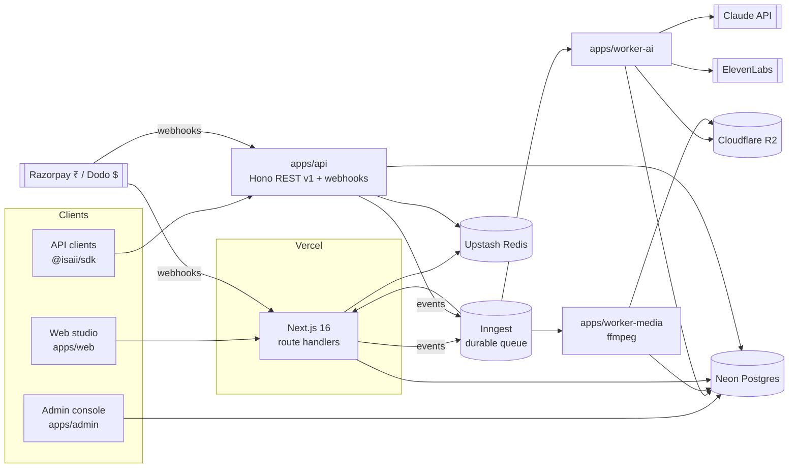

# ISAII architecture

ISAII is an India-first AI podcast studio: a topic, recording or script becomes a researched,
voiced, packaged episode in 21 languages (11 Indian + Hinglish/Tanglish + global).

## System



## Layers (enforced by ESLint `boundaries/dependencies`)

| Layer | Packages | May import |
|---|---|---|
| app | `apps/*` | domain, capability, ai-core, platform |
| tooling | `evals` | domain, capability, ai-core, platform |
| domain | `domain-identity`, `domain-billing`, `domain-episodes`, `domain-publishing`, `domain-shows` | domain, capability, ai-core, platform |
| capability | `agents`, `voice`, `media`, `guardrails`, `db`, `storage`, `queue`, `ui`, `sdk` | capability, ai-core, platform |
| ai-core | `ai-gateway`, `prompts` | ai-core, platform |
| platform | `core`, `env`, `logger`, `telemetry`, `cache`, `flags`, `i18n`, `contracts`, `security`, `config` | platform |

Rules: nothing imports an app; domain code never imports Next.js; vendors (LLM, TTS/STT, storage,
queue, payments) live behind interfaces so adding Sarvam for Indic voice or another LLM is a new adapter.

## Episode lifecycle

```mermaid
stateDiagram-v2
  [*] --> queued: POST /generations (credits charged)
  queued --> researching --> scripting --> evaluating --> awaiting_selection
  queued --> failed: queue error (refund)
  scripting --> failed: permanent failure (refund)
  awaiting_selection --> producing: creator picks angle + length
  producing --> complete
  producing --> partial_failure: thumbnails or SEO failed, audio ok
  producing --> failed
  complete --> [*]
```

Every Inngest step is retried and memoised on its own, so a retry never repeats paid work.

## Data

Drizzle schema in `packages/db/src/schema/` (split by domain), migrations in `packages/db/migrations/`.
Money is stored in minor units. OAuth tokens are encrypted at rest (AES-256-GCM) when `TOKEN_ENCRYPTION_KEY` is set.

## Quality

- Unit + integration tests in every package (Vitest; PGlite for Postgres; MemoryKV; fake AI/TTS/storage).
- `@isaii/evals` measures AI output quality per language with deterministic checks and a Claude judge;
  baselines in `packages/evals/baselines/`. Run: `npm run eval -- --langs hi,ta,kn --judge --budget 3`.
